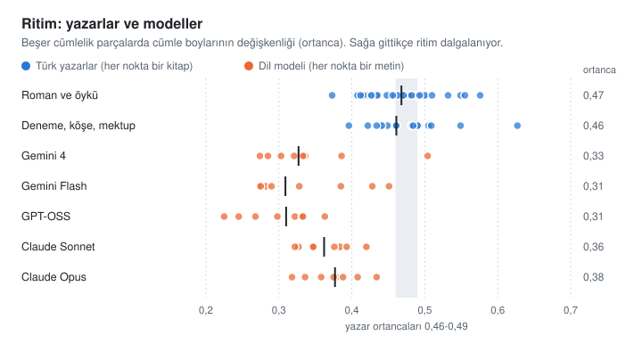

# yapay-degil

Yapay zekâya Türkçe yazdırınca bir şey hep tuhaf durur. Kelimeler Türkçedir ama cümleler İngilizceden çevrilmiş gibidir. Her paragraf "Günümüzde" diye açılır, "Sonuç olarak" diye kapanır, aradaki cümlelerin hepsi aynı boydadır. Bu depo o tuhaflığı gideren bir skill. Claude, Cursor, Gemini CLI gibi yapay zekâ araçlarında çalışır, metni sıfırdan doğal Türkçeyle yazdırır ya da elindeki metni onarır.

[](LICENSE)
[](https://agentskills.io/specification)
[](https://github.com/neverland-lab/yapay-degil/issues/new/choose)

Kurmadan denemek istersen [tarayıcıdaki denetçiye](https://neverland-lab.github.io/yapay-degil/) metin yapıştırabilirsin. Yapay duran yerleri işaretler, nedenini örnekle anlatır. Metin bilgisayarından çıkmaz.

*Turkish AI-text humanizer for Claude and other agents. Its rules are calibrated on 2.7 million words of Turkish writing: novels, essays, columns, letters, papers, technical and official documents.*

## Önce bir örnek

Gemini Flash'tan gelenek ve modern hayat üzerine bir deneme istedik. İlk paragrafı şuydu:

> Modern insanın zamanla kurduğu ilişki, tarihte hiç olmadığı kadar hız ve yenilik ekseninde şekilleniyor. Her sabah yeni bir teknolojik sıçrayışa, değişen normlara ve eskimeye mahkûm tüketim nesnelerine uyanıyoruz. Bu baş döndürücü devinim içinde gelenek kavramı, çoğu zaman ilerlemenin önündeki köhne bir engel, geçmişin tozlu sayfalarına hapsolmuş bir pranga gibi algılanabiliyor. Oysa insanı bütünüyle bugünden ibaret saymak, nehrin yalnızca gözümüzün önünden geçen damlasını su zannedip kaynağını ve yatağını inkâr etmeye benzer. Geleneğin modern hayattaki yeri, geçmişe duyulan romantik bir özlemden ya da katı bir muhafazakârlıktan çok daha derin; varoluşsal bir çıpa ve anlam arayışıdır.

Skill'le onarılmış hâli:

> Modern insanın zamanla ilişkisini hız ve yenilik belirliyor. Tarihte hiç bu kadar olmamıştı. Her sabah yeni bir teknolojik sıçrayışa, değişen normlara, eskimeye mahkûm eşyalara uyanıyoruz. Bu hızın içinde gelenek çoğu zaman ilerlemenin önünde duran eski bir engel gibi görülebiliyor, geçmişten kalma bir pranga gibi. Ama insanı yalnızca bugünden ibaret saymak, nehrin önümüzden akıp giden damlasını su sanıp kaynağını da yatağını da inkâr etmeye benzer. Geleneğin bugünkü hayattaki yeri daha derin. Geçmişe duyulan romantik bir özlem değil o, katı bir muhafazakârlık da değil: varoluşsal bir çıpa, bir anlam arayışı.

İki paragrafta da aynı şey söyleniyor. Hiçbir bilgi eklenmedi, "görülebiliyor"daki ihtimal bile yerinde duruyor. Gidenler süslerdi: "baş döndürücü devinim", "tozlu sayfalarına hapsolmuş", "ekseninde şekilleniyor", bir de iki ayrı cümleyi birbirine yapıştıran noktalı virgül.

Asıl fark, cümlelerin boyuna bakınca görünüyor:

<picture>
  <source media="(prefers-color-scheme: dark)" srcset="docs/img/cumle-boylari-dark.svg">
  
</picture>

Model her cümleyi aynı kalıba döküyor. Yazarlar kısa cümleyle uzun cümleyi yan yana kullanır, ölçtüğümüz Türk yazarlarda bu değişkenlik 0,46-0,49. Okur cümleleri saymaz ama bu tekdüzeliği hisseder.

Bir itirafımız var: Bu örneği hazırlarken ilk onarımımız ritmi düzeltmedi, daha da düzleştirdi. Cümleler 15, 12, 18, 17, 15 kelimeye dizilmişti. Bunu depodaki küçük dedektör betiği yakaladı, biz değil. Cümleleri yeniden kurduk, sonuç yukarıda.

## Kuralları nereden bulduk?

Skill'in ilk hâlinde "insanlar 18-22 kelimelik cümlelere sıkışmaz", "on cümlede bir kısa cümle kur" gibi kurallar vardı. Kulağa doğru geliyordu ama hiçbirinin dayanağı yoktu. Biz de saydık.

Doğrudan Türkçe yazılmış 145 metin topladık, toplam 2,7 milyon kelime. Sait Faik'ten Oğuz Atay'a eski romanlar ve öyküler, Hakan Günday'dan Ayfer Tunç'a, Burhan Sönmez'e 2000 sonrası romanlar ilk sırada. Yanlarında denemeler, köşe yazıları, Sabahattin Ali'nin mektupları, Atay'ın günlüğü, Cüceloğlu'ndan Geçtan'a psikoloji kitapları duruyor. Bilim ve devlet dili için de DergiPark'tan 44 makale, 19 teknik belge, Sayıştay raporları ve belediye faaliyet raporları aldık. Çeviri kitapları bilerek dışarıda bıraktık, çünkü çeviri Türkçesi tam da temizlemeye çalıştığımız izleri taşıyor. Aynı yazma isteklerini beş dil modeline de verdik (Gemini 4, Gemini Flash, GPT-OSS, Claude Sonnet, Claude Opus) ve modellerin yazdıklarını insan metinleriyle aynı ölçümlerden geçirdik.

Kitaplarda ne anlatıldığına bakmadık. Bize bir yazarın cümlesini kaç kelimeyle kurduğu, ne sıklıkla soru sorduğu, yüklemi ne zaman sona bıraktığı lazımdı. Skill'in içinde hiçbir kitaptan tek bir cümle yok. Depoda yalnızca sayılar var, örnek cümleleri biz kurduk. Hepsi [`references/derlem-olcumleri.md`](references/derlem-olcumleri.md) dosyasında.

Çıkanların bir kısmı beklediğimiz gibi değildi.

İnsanı modelden asıl ayıran ritim çıktı. Metni art arda beşer cümlelik parçalara bölüp her parçada cümle boylarının ne kadar değiştiğine baktık. Bu değişkenlik yazarlarda 0,46-0,49, modellerde 0,28-0,41. Üstelik modeller tek tip de değil. Gemini ve GPT cümleleri orta boyda topluyor. Claude ise yazarlardan bile kısa yazıyor ama onun cümleleri de hep aynı boyda. "Kısa cümle ekle" önerisi bu yüzden Claude'a hiç yaramıyordu.

<picture>
  <source media="(prefers-color-scheme: dark)" srcset="docs/img/ritim-dark.svg">
  
</picture>

Yazdıklarımızın bir kısmı da insan yazısını bozuyormuş. Skill "ama"dan önceki virgülü İngilizce alışkanlığı sayıp siliyordu. Saydık: Türk yazarlar "ama"ların dörtte birinin önüne virgül koyuyor, modeller daha az. "Ki" bağlacını da şüpheli sayıyorduk, oysa yazarlar onu modellerden sık kullanıyor: demek ki, öyle ki, kaldı ki. İki kuralı da kaldırdık.

Devrik cümleyi dönem değil yazar belirliyor. 2000 sonrası romanlarda oran %4 ile %37 arasında değişiyor. Aynı yazarın eski ve yeni kitabını karşılaştırınca da yön tutarsız çıkıyor: Pamuk'ta ve Toptaş'ta artıyor, Mungan'da azalıyor.

Kurum dilinin uzun cümleleri ve art arda "-mıştır"la biten paragrafları yapay zekâdan önce de vardı. İBB'nin 2018-2020 faaliyet raporlarıyla 2023-2024 raporları aynı aralıkta çıktı. Skill bu yüzden kamu yazışmasında o dile dokunmuyor.

Ders kitabı ve popüler bilim yazısının ritmi romandan daha düzenli. Bu kitaplarda cümle boyu değişkenliği 0,38-0,48 arasında. Skill orada edebî ritmi zorlamıyor.

Bir de yan bulgumuz var. 2026'da yayımlanan makaleler 2016-2019'dakilerden farklı yazılıyor: cümle sonunda "-dır" kullanımı yarıya inmiş, aynı ekle biten seriler uzamış. Yapay zekânın izi olabilir ama örneklem küçük, şimdilik gözlem olarak duruyor.

## Model mi eğittiniz?

Hayır, bilerek eğitmedik. Skill bir talimat dosyası. Model, metni yazarken ya da onarırken bu talimatlara bakıyor. Biz talimatlardaki her sayıyı ölçülmüş bir değere bağladık ve her değişikliği denedik.

Deneme düzenimiz şöyle: Aynı istekleri skill'li ve skill'siz yazdırıyoruz, çıkan metinleri ölçüyoruz, sonra etiketlerini silip karışık sırayla başka bir modele (Gemini) okutuyoruz. Okur hangisinin skill'li olduğunu bilmiyor. Sıfırdan yazımda skill'le yazılan metin 8 isteğin 8'inde daha doğal bulundu. Onarımda 8 metnin 7'sinde onarılmış sürüm, modelin ilk yazdığı metnin önüne geçti. Deneyler küçük, okur da bir model. Sayılar yön gösteriyor, kesin hüküm vermiyor. Sırada insan okurlarla yapacağımız bir deney var.

Her deney işe yaramadı. Akademik metinde ritmi artıran bir kural denedik. Sayılar iyileşti ama okur metni daha yapay buldu, kuralı geri aldık. Gemini'nin fazla devrik cümle kurmasını iki farklı talimatla düzeltmeye çalıştık, ikisi de tutmadı. Bunların hepsi ölçüm dosyasında "denendi, eklenmedi" diye duruyor.

## Kurulum

En kısası:

```bash
npx skills add neverland-lab/yapay-degil
```

GitHub CLI kullanıyorsan:

```bash
gh skill install neverland-lab/yapay-degil
```

Claude Code'da eklenti olarak. Bu iki satır terminale değil, Claude Code'un sohbet kutusuna yazılır:

```text
/plugin marketplace add neverland-lab/yapay-degil
/plugin install yapay-degil@yapay-degil
```

Ya da elle:

```bash
# Claude Code
git clone https://github.com/neverland-lab/yapay-degil.git ~/.claude/skills/yapay-degil

# Codex, Gemini CLI, Cursor, Windsurf
git clone https://github.com/neverland-lab/yapay-degil.git ~/.agents/skills/yapay-degil
```

Cursor kuralı olarak:

```bash
mkdir -p .cursor/rules
curl -sL https://raw.githubusercontent.com/neverland-lab/yapay-degil/main/.cursor/rules/yapay-degil.mdc \
  -o .cursor/rules/yapay-degil.mdc
```

Klasör yükleyemediğin web arayüzlerinde (claude.ai projeleri, ChatGPT, Google AI Studio) her şeyin tek dosyada toplandığı [`dist/yapay-degil.full.md`](dist/yapay-degil.full.md) dosyasını talimat ya da bilgi alanına yapıştırabilirsin.

## Kullanım

Kurduktan sonra ne istediğini söylemen yeterli:

- "Şu blog yazısını insanlaştır: ..."
- "Önbellek geçersizleştirme konusunu teknik bir dille, doğal Türkçeyle yaz."
- "Bu metne dokunma, yalnızca yapay duran yerleri ve TDK hatalarını göster."

Skill metnin türüne göre davranır. Akademik makaledeki "-mektedir"e dokunmaz, blog yazısında onu ayıklar. Kurum içi yazışmanın resmî dilini gündelik dile çekmez. Romanda devrik cümleye izin verir, teknik belgede vermez. Altı metin türü tanımlı: blog ve deneme, teknik, kurumsal, akademik, edebî, kamu ve kurum içi yazışma.

Bir kuralı hiç esnetmez: Onarırken kaynakta olmayan sayı, isim, anekdot eklemez. "İnsan gibi görünmek" için uydurmaz.

## Dedektör

Skill'in yanında küçük bir Python betiği var. Metni okuyup kalıpları, TDK hatalarını, cümle ritmini ve "-mektedir" yoğunluğunu raporlar. Ek kütüphane istemez, internete bağlanmaz. Aynı dedektör [web sayfasında](https://neverland-lab.github.io/yapay-degil/) tarayıcıda da çalışıyor, kurallar ortak.

```bash
python3 scripts/detect_tr_ai.py metin.md
python3 scripts/detect_tr_ai.py makale.md --register akademik-resmi
python3 scripts/detect_tr_ai.py yazi.md --register kamu-kurum
python3 scripts/detect_tr_ai.py metin.md --json
```

Dedektör yalnızca yüzeye bakar. Cümle kuruluşunu düzeltmek modelin işi, dedektör sonuca bakıp "burada ritim düz" ya da "burada beş cümle aynı ekle bitiyor" der. Uyarılarını insan metinleri üzerinde sınadık: Derlemin tamamını dedektörden geçirdik ve insan yazısına sık sık yanlış alarm veren kuralları gevşettik. Eşiklerin kaynağı yine ölçüm dosyasında.

## İçinde ne var?

```text
SKILL.md                      Ana talimat: çalışma adımları, metin türleri, öz denetim
references/
  derlem-olcumleri.md         Derlem ölçümleri, deney sonuçları
  sentaks-ve-morfoloji.md     Türkçe cümle kuruluşu: öge dizilimi, ulaçlar, koşutluk
  ai-turkcesi-sozlugu.md      Yapay zekâ Türkçesi kalıpları
  tdk-ve-noktalama.md         Noktalama ve yazım kuralları, kaynaklarıyla
  register-ve-ornekler.md     Metin türleri ve önce/sonra örnekleri
scripts/                      Dedektör, testler, paketleme
docs/                         Tarayıcı denetçisi (web sayfası), araştırma notları
dist/                         Web arayüzleri için tek dosya
skills/yapay-degil/           Kurulumda inen paket (betik içermez)
```

Betikler hakkında: `detect_tr_ai.py` ve `run_tests.py` dosya yazmaz. `build_dist.py` yalnızca depo içinde çalışır: `dist/` dosyasını yeniden yazar, `skills/yapay-degil/references/` klasörünü silip yeniden kopyalar. Silme bu tek klasörle sınırlı, başka bir yol ya da sembolik bağlantı görürse durur. `npx skills` ya da `gh skill` ile kurulumda yalnızca `skills/yapay-degil/` iner, orada betik yoktur. `build_site.py` web sayfasının kural dosyasını (`docs/site/kurallar.js`) dedektörden üretir. `check_site.py` dosya yazmaz, Node.js ile sayfanın dedektörle aynı sonucu verdiğini sınar.

## Öneri ve hata bildirimi

Skill yanlış bir düzeltme yaptıysa ya da yapay duran yeni bir kalıp gördüysen [Issues](https://github.com/neverland-lab/yapay-degil/issues/new/choose) bölümünden yaz. Hata ve öneri için iki kısa şablon var. Değişikliği kendin yapmak istersen pull request de açabilirsin, nasıl yapılacağı [CONTRIBUTING.md](CONTRIBUTING.md) dosyasında.

## Sürümler

Her sürümde neyin değiştiği [CHANGELOG.md](CHANGELOG.md) dosyasında. Şu anki sürüm 1.3.2.

## Teşekkür ve lisans

Bu proje [Yüce Zerey'in turkish-anti-ai-skill](https://github.com/yucezerey/turkish-anti-ai-skill) deposundan doğdu. Üç katmanlı yapı, metin türü tablosu ve dedektörün ilk hâli oradan geliyor. Derlem ölçümleri, ölçülmüş eşikler, koşutluk kuralları, kamu yazışması türü ve deneyler bu depoya eklendi. TDK kuralıyla üslup tercihini ayıran düzeltmelerimiz Kasım 2026'da ana depoya da birleştirildi.

[MIT lisansı](LICENSE) ile dağıtılıyor.
