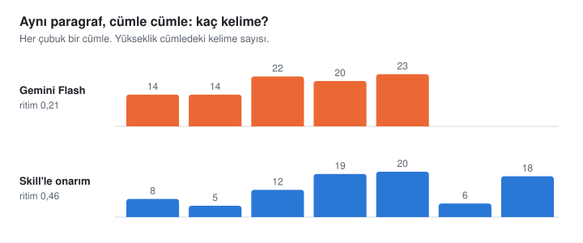

# yapay-degil

Yapay zekâya Türkçe yazdırınca bir şey hep tuhaf durur. Kelimeler Türkçedir ama cümleler İngilizceden çevrilmiş gibidir. Cümlelerin hepsi aynı boydadır, paragraf bir duyuruyla açılır, "Sonuç olarak" diye kapanır. Bu depo o tuhaflığı gideren bir skill. Claude, Cursor, Gemini CLI gibi yapay zekâ araçlarında çalışır, metni sıfırdan doğal Türkçeyle yazdırır ya da elindeki metni onarır.

[](LICENSE)
[](https://agentskills.io/specification)
[](https://github.com/neverland-lab/yapay-degil/issues/new/choose)

Kurmadan denemek istersen [tarayıcıdaki denetçiye](https://neverland-lab.github.io/yapay-degil/) metin yapıştırabilirsin. Yapay duran yerleri işaretler, nedenini örnekle anlatır. Metin bilgisayarından çıkmaz.

*Turkish AI-text humanizer for Claude and other agents. Its rules are measured, not guessed: 1.1 million words of Turkish writing compared side by side with 200 texts from six language models.*

## Önce bir örnek

Gemini Flash'tan gelenek ve modern hayat üzerine bir deneme istedik. İlk paragrafı şuydu:

> Modern insanın zamanla kurduğu ilişki, tarihte hiç olmadığı kadar hız ve yenilik ekseninde şekilleniyor. Her sabah yeni bir teknolojik sıçrayışa, değişen normlara ve eskimeye mahkûm tüketim nesnelerine uyanıyoruz. Bu baş döndürücü devinim içinde gelenek kavramı, çoğu zaman ilerlemenin önündeki köhne bir engel, geçmişin tozlu sayfalarına hapsolmuş bir pranga gibi algılanabiliyor. Oysa insanı bütünüyle bugünden ibaret saymak, nehrin yalnızca gözümüzün önünden geçen damlasını su zannedip kaynağını ve yatağını inkâr etmeye benzer. Geleneğin modern hayattaki yeri, geçmişe duyulan romantik bir özlemden ya da katı bir muhafazakârlıktan çok daha derin; varoluşsal bir çıpa ve anlam arayışıdır.

Skill'le onarılmış hâli:

> Modern insanın zamanla ilişkisini hız ve yenilik belirliyor. Tarihte hiç bu kadar olmamıştı. Her sabah yeni bir teknolojik sıçrayışa, değişen normlara, eskimeye mahkûm eşyalara uyanıyoruz. Bu hızın içinde gelenek çoğu zaman ilerlemenin önünde duran eski bir engel gibi görülebiliyor, geçmişten kalma bir pranga gibi. Ama insanı yalnızca bugünden ibaret saymak, nehrin önümüzden akıp giden damlasını su sanıp kaynağını da yatağını da inkâr etmeye benzer. Geleneğin bugünkü hayattaki yeri daha derin. Geçmişe duyulan romantik bir özlem değil o, katı bir muhafazakârlık da değil: varoluşsal bir çıpa, bir anlam arayışı.

İki paragrafta da aynı şey söyleniyor. Hiçbir bilgi eklenmedi, "görülebiliyor"daki ihtimal bile yerinde duruyor. Gidenler süslerdi: "baş döndürücü devinim", "tozlu sayfalarına hapsolmuş", "ekseninde şekilleniyor", bir de iki ayrı cümleyi birbirine yapıştıran noktalı virgül.

Asıl fark, cümlelerin boyuna bakınca görünüyor:

<picture>
  <source media="(prefers-color-scheme: dark)" srcset="docs/img/cumle-boylari-dark.svg">
  
</picture>

Model her cümleyi aynı kalıba döküyor. Yazarlar kısa cümleyle uzun cümleyi yan yana kullanır. Okur cümleleri saymaz ama bu tekdüzeliği hisseder.

## Kuralları nereden bulduk?

Saydık. Doğrudan Türkçe yazılmış kitap, makale ve belge topladık: Sait Faik'ten Oğuz Atay'a eski romanlar ve öyküler, Hakan Günday'dan Ayfer Tunç'a 2000 sonrası romanlar, denemeler, köşe yazıları, mektuplar ve günlükler, psikoloji kitapları, DergiPark makaleleri, teknik belgeler, Sayıştay ve belediye raporları. Çeviri kitapları bilerek dışarıda bıraktık, çünkü çeviri Türkçesi tam da temizlemeye çalıştığımız izleri taşıyor. Sonra altı dil modeline (Gemini 4, Gemini Flash, GPT-OSS, Claude Haiku, Sonnet ve Opus) aynı türlerde iki yüz metin yazdırdık ve iki tarafı aynı ölçümlerden geçirdik.

Kitaplarda ne anlatıldığına bakmadık. Bize bir yazarın cümlesini kaç kelimeyle kurduğu, ne sıklıkla soru sorduğu, cümleyi hangi sözle açtığı lazımdı. Depoda hiçbir kitaptan tek bir cümle yok, yalnızca sayılar var. Örnek cümleleri biz kurduk. Sayıların tamamı [`docs/olcumler.md`](docs/olcumler.md) dosyasında.

Çıkanların bir kısmı beklediğimiz gibi değildi.

İnsanı modelden asıl ayıran ritim çıktı, hem de her türde. Art arda gelen beş cümlenin boyu ne kadar değişiyor diye baktık. Bu değişkenlik yazarlarda 0,41 ile 0,48 arasında, modellerde 0,27 ile 0,40.

| | Öykü, roman | Deneme | Açıklayıcı | Teknik | Akademik | Kamu |
| :--- | :--- | :--- | :--- | :--- | :--- | :--- |
| Yazarlar | 0,48 | 0,48 | 0,41 | 0,46 | 0,46 | 0,46 |
| Modeller | 0,40 | 0,33 | 0,33 | 0,33 | 0,27 | 0,27 |

Resmî dil bile böyle. Bir belediye raporunun cümleleri uzundur ama boyları değişir. Modelin yazdığı raporda hepsi aynı boydadır.

Yasakladığımız sözlerin bir kısmı suçsuzmuş. "Âdeta", "söz konusu", "kuşkusuz", "bir şekilde" gibi sözleri uzun süre yapay zekâ izi saydık. Sayınca yazarların bunları modellerden sık kullandığı çıktı, listeden çıkardık. "Ama"dan önceki virgül ve "ki" bağlacı için de aynısı oldu. Gerçekten ayıran sözler başkaymış: "değer katar", "zemin hazırlar", "tam da bu noktada", "bir diğer önemli nokta", "sadece X değil, aynı zamanda Y". Bunlar yazarlarda on bin kelimede bir bile geçmiyor.

Model cümleyi bir geçiş sözüyle açıyor. Akademik metinde her beş cümlesinden biri "Ayrıca", "Bu doğrultuda", "Sonuç olarak", "Üçüncü olarak" diye başlıyor. Yazarlarda on dört cümleden biri. Yazarlar cümleyi çoğunlukla "Ve", "Ama", "Çünkü" ile ya da hiçbir şeyle açıyor.

Model soru sormuyor. Deneme ve öyküde yazarların bin kelimesinde sekiz soru işareti var, modelde bir ile üç arası. Ünlem ve üç nokta da öyle.

Kurum dilinin uzun cümleleri ve art arda "-mıştır"la biten paragrafları yapay zekâdan önce de vardı. İBB'nin 2018-2020 faaliyet raporlarıyla 2023-2024 raporları aynı aralıkta çıktı. Skill bu yüzden kamu yazışmasında o dile dokunmuyor.

Devrik cümleyi dönem değil yazar belirliyor. 2000 sonrası romanlarda oran %4 ile %37 arasında değişiyor, aynı yazarın iki kitabında bile yön tutmuyor.

## İşe yarıyor mu?

Bunu ölçümden ayrı sınıyoruz, çünkü sayıyı düzelten kural metni her zaman iyileştirmiyor. Düzenimiz şu: Aynı metinleri iki ayrı talimatla onartıyoruz, etiketlerini silip karışık sırayla başka bir modele (Gemini) okutuyoruz. Okur hangisinin hangisi olduğunu bilmiyor.

1.x sürümlerinde skill'le yazılan metin 8 isteğin 8'inde, onarılan metin 8 metnin 7'sinde skill'siz olanın önüne geçti. Son sınamada okur, 1.3.3 ile onarılmış metni kaynağına karşı 16 karşılaştırmanın 16'sında seçti.

2.0'ın yeniden yazılan skill metni ise aynı sınamada 1.3.3'ü geçemedi: okur 14 karşılaştırmanın 10'unda eski sürümün onarımını seçti. Bir ara taslak ritmi yazar düzeyine çıkarıp skoru yarıya indirmişti, okur onu daha da az beğendi. Ayrıntısı [ölçüm belgesinde](docs/olcumler.md#skill-metninin-sınanması). Deneyler küçük, okur da bir model. Sırada insan okurlarla yapacağımız bir deney var.

Her deney işe yaramadı. Akademik metinde ritmi artıran bir kural denedik. Sayılar iyileşti ama okur metni daha yapay buldu, kuralı geri aldık. Gemini'nin fazla devrik cümle kurmasını iki farklı talimatla düzeltmeye çalıştık, ikisi de tutmadı. Bunların hepsi ölçüm dosyasında duruyor.

## Kurulum

En kısası:

```bash
npx skills add neverland-lab/yapay-degil
```

GitHub CLI kullanıyorsan:

```bash
gh skill install neverland-lab/yapay-degil
```

Claude Code'da eklenti olarak. Bu iki satır terminale değil, Claude Code'un sohbet kutusuna yazılır:

```text
/plugin marketplace add neverland-lab/yapay-degil
/plugin install yapay-degil@yapay-degil
```

Ya da elle:

```bash
# Claude Code
git clone https://github.com/neverland-lab/yapay-degil.git ~/.claude/skills/yapay-degil

# Codex, Gemini CLI, Cursor, Windsurf
git clone https://github.com/neverland-lab/yapay-degil.git ~/.agents/skills/yapay-degil
```

Cursor kuralı olarak:

```bash
mkdir -p .cursor/rules
curl -sL https://raw.githubusercontent.com/neverland-lab/yapay-degil/main/.cursor/rules/yapay-degil.mdc \
  -o .cursor/rules/yapay-degil.mdc
```

Klasör yükleyemediğin web arayüzlerinde (claude.ai projeleri, ChatGPT, Google AI Studio) her şeyin tek dosyada toplandığı [`dist/yapay-degil.full.md`](dist/yapay-degil.full.md) dosyasını talimat ya da bilgi alanına yapıştırabilirsin.

## Kullanım

Kurduktan sonra ne istediğini söylemen yeterli:

- "Şu blog yazısını insanlaştır: ..."
- "Önbellek geçersizleştirme konusunu teknik bir dille, doğal Türkçeyle yaz."
- "Bu metne dokunma, yalnızca yapay duran yerleri ve yazım hatalarını göster."

Skill metnin türüne göre davranır. Akademik makaledeki "-mektedir"e dokunmaz, blog yazısında onu ayıklar. Kurum içi yazışmanın resmî dilini gündelik dile çekmez. Romanda devrik cümleye izin verir, teknik belgede vermez. Yedi tür tanımlı: blog ve deneme, öykü ve roman, şirket yazısı, ders kitabı ve popüler bilim, teknik belge, akademik yazı, kamu ve kurum içi yazışma.

Bir kuralı hiç esnetmez: Onarırken kaynakta olmayan sayı, isim, anı eklemez. "İnsan gibi görünmek" için uydurmaz.

## Denetçi

Skill'in içinde küçük bir Python betiği var. Model taslağını yazdıktan sonra onu çalıştırır, kod çalıştıramadığı ortamda aynı denetimi elle yapar. Betiği kendin de kullanabilirsin:

```bash
python3 scripts/denetle.py metin.md
python3 scripts/denetle.py makale.md --tur akademik
python3 scripts/denetle.py onarilmis.md --kaynak ilk-hali.md
python3 scripts/denetle.py metin.md --json
```

Cümle boylarını sayar ve düz kalan yerleri cümle numarasıyla gösterir. Kalıpları ve yazım hatalarını listeler, kesin düzeltmesi olanların doğrusunu yazar. `--kaynak` verirsen iki metni karşılaştırır: kaynaktaki sayılar ve adlar çıktıda duruyor mu, çıktıya yeni bir sayı ya da ad girmiş mi, "olabilir", "bazı", "gibi" türünden ihtiyat sözleri azalmış mı. Ek kütüphane istemez, dosya yazmaz, internete bağlanmaz. Aynı denetçi [web sayfasında](https://neverland-lab.github.io/yapay-degil/) tarayıcıda da çalışıyor, kurallar ortak.

Raporun başında 0-100 arası bir "yapay zekâ izi" skoru var, altında da nereden geldiği yazıyor. Skor derlemden hesaplandı ve hiç görmediği kitaplarla sınandı. Seksen ve üstü alan parçalar: model metinlerinin %59-81'i, yazar metinlerinin %1-10'u. Elli ve üstünde ise deneme yazarlarının dört beş parçasından biri de var. Yani skor tek başına "bunu yapay zekâ yazdı" demeye yetmez ve bir öğrencinin ödevi hakkında hüküm vermek için kullanılmamalı. İşe yaradığı yer, bir onarımın metni gerçekten değiştirip değiştirmediğini görmek. Sekiz cümleden kısa metinde skor üretilmez.

## İçinde ne var?

```text
SKILL.md                      Ana talimat
references/
  cumle-kurulusu.md           Türkçe cümlenin düzeni, ulaçlar, koşutluk
  kaliplar.md                 Modelin sevdiği sözler, sıklıklarıyla
  yazim-ve-noktalama.md       Noktalama ve yazım kuralları
  metin-turleri.md            Yedi tür ve önce/sonra örnekleri
  olculer.md                  Türlere göre ölçülmüş değerler
scripts/
  denetle.py                  Denetçi
  kurallar.py                 Kurallar, açıklamaları, skor katsayıları
docs/                         Web sayfası ve ölçüm belgesi
dist/                         Web arayüzleri için tek dosya
skills/yapay-degil/           Kurulumda inen paket
araclar/                      Derleme, test ve ölçüm betikleri
```

`npx skills` ya da `gh skill` ile kurulumda yalnızca `skills/yapay-degil/` iner: `SKILL.md`, `references/` ve iki betik. `dist/`, `skills/` ve web sayfasının kural dosyası elle düzenlenmez, `araclar/derle.py` üretir. Bu betik yalnızca depo içine yazar.

## Öneri ve hata bildirimi

Skill yanlış bir düzeltme yaptıysa ya da yapay duran yeni bir kalıp gördüysen [Issues](https://github.com/neverland-lab/yapay-degil/issues/new/choose) bölümünden yaz. Değişikliği kendin yapmak istersen pull request de açabilirsin, nasıl yapılacağı [CONTRIBUTING.md](CONTRIBUTING.md) dosyasında.

## Sürümler

Her sürümde neyin değiştiği [CHANGELOG.md](CHANGELOG.md) dosyasında. Şu anki sürüm 2.0.0. 1.x'ten gelenler için: dedektörün adı `detect_tr_ai.py` yerine `denetle.py`, `--register` yerine `--tur` oldu (eski tür adları da çalışıyor), referans dosyalarının adları değişti.

## Teşekkür ve lisans

Bu proje [Yüce Zerey'in turkish-anti-ai-skill](https://github.com/yucezerey/turkish-anti-ai-skill) deposundan doğdu. Metni katman katman onarma fikri, metin türü tablosu ve dedektörün ilk hâli oradan geliyor. Derlem ölçümleri, ölçülmüş kalıp sözlüğü, koşutluk kuralları, kamu yazışması türü, skor ve deneyler bu depoya eklendi.

[MIT lisansı](LICENSE) ile dağıtılıyor.
